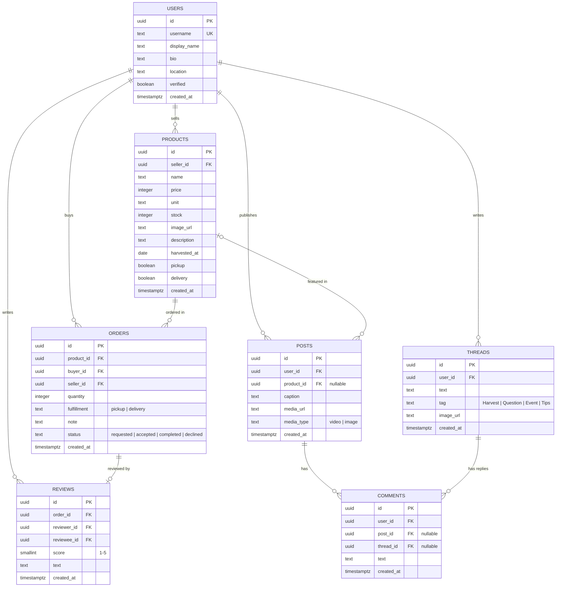

# Database design (draft)

Target: **Supabase (PostgreSQL)**. All primary keys are **UUIDs**, so data can later be
moved to a distributed database without changing IDs. The TypeScript types in
`src/lib/types.ts` follow this schema.

## Notes

- **Likes** will be a separate table (`likes(user_id, post_id | thread_id)`), not a counter column,
  so a user can only like once.
- **Rating** (`User.rating`, `User.reviewCount` in the mock) will be computed from `REVIEWS`,
  and only reviews linked to a *completed* order count — this makes fake reviews harder.
- Row Level Security: users can only edit their own rows; sellers can only change the status of orders they received.
