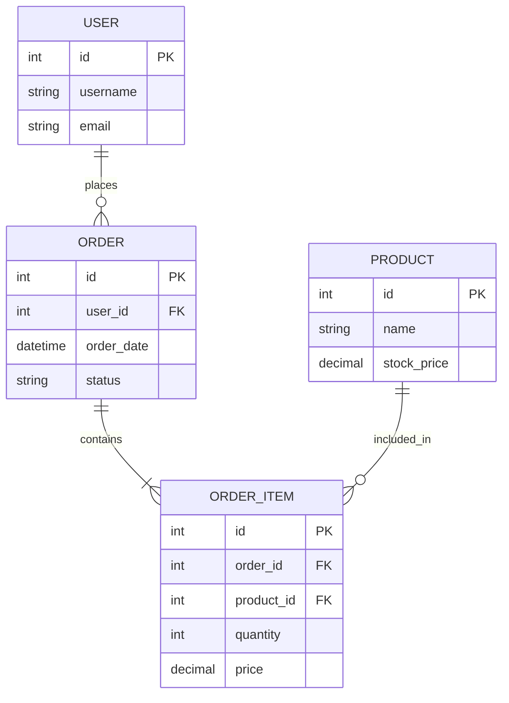

# 🚀 Sprint 01（2026/04/27 - 05/02）

## Premise
- このmdファイルはスプリントプランごとに作成し、目標・設計・タスク・振返りを共有する
スプリント期間中の"正"となるドキュメント

### mdファイルとは？
IT業界のドキュメント共有では標準語として使われているテキスト形態です。
メモ帳、VS Code、スマホ、ブラウザ、OSなど、どんな環境でも中身を確認できます。
### mdファイルを使ったDocs as Codeとは？
これまで、プログラムはGitHubで、設計書はExcelやWordでバラバラに管理されてきました。
これをコードと同じテキスト形式に統一することで、開発効率を劇的に上げる手法です。
https://zenn.dev/dajiaji/articles/24086666031199

## Project
- Instagram風UIの動的ECプラットフォーム開発

## 🎯 Goal - Sprint 01
- ① Markdown & アジャイル運用を学ぶ
- ② アジャイル開発ルールを考える
- ③ 開発環境構築
- ④ モックアップ作成
- ⑤ スプリントレビュー

## Tasks

### ① Markdown & アジャイル運用を学ぶ
- [x] 開発ドキュメントをすべて .md で管理する体験
- [x] Excel設計書を廃止し、GitHub上の .md で設計共有を行う
- [x] 完了タスクを `[x]` に更新してPushする

### ② アジャイル開発ルールを考える
- [x] 使用オープンソースを決める【候補】

| 技術 | 費用 | 特徴・採用理由 |
| :--- | :--- | :--- |
| **Next.js** | 無料 (MIT) | Reactベースの標準フレームワーク。 |
| **Tailwind CSS** | 無料 (MIT) | インライン記述、CSSファイルを分けない。 |
| **dbdiagram.io** | 基本無料 | DBML(テキスト形式)設計。VS Codeと連携してER図を自動描画できるらしい。 |
| **Supabase** | 基本無料 | 認証・DB・ストレージがセット。億単位のデータ拡張性あり。⇐項目の作成機能を作るなら後々レコードが万～億単位になるから、どうDBをスケーラブルするか考えないといけないね。。。インスタは最初1つのRDBでやってたけど、すぐあきらめて分散DBにかえたらしい。今は考えなくてよいけど、IDだけはUUIDにしておくべき |

---
### ③ 開発環境構築
- [x] GitHub セットアップ
- [ ] Supabase セットアップ
- [ ] VS Code 拡張機能導入
(ESLint : 文法チェッカ－, 
Prettier : インデント自動で整える, 
Tailwind :  CSSの入力候補補完,
vscode-dbml  :  dbdiagram.ioの描画)

### ④ モックアップ
- [x] イメージ共有

### ⑤ スプリントレビュー
- [ ] 日曜日のスプリントレビュー（JST 21:00 / FR 12:00）の実施（仮）


## 📅 Plan（第1週）

| Day | Task | Owner | Status |
|-----|------|-------|--------|
| 月-火 | ① | 2人 | In Progress |
| 水-金 | ② | 2人 | Todo |
| 土 | ③④ | 2人 | Todo |
| 日 | ⑤ | 2人 | Todo |

---

## ️ ソース
mockできたらここに貼り付けてね。VScodeで開けば、レンダリングされた状態で表示できるんだって
やり方: VS Codeでこのファイルを開き、Ctrl + Shift + V (Macは Cmd + Shift + V) を押下
構想共有もここでできたらいいな。Reactの書き方も学んどきます。（要検討）
↓
```tsx
// ここにコードを貼る
export default function ProductCard() {
  return (
    <div className="p-4 bg-white shadow-lg rounded-2xl border border-gray-200">
      <h2 className="text-xl font-bold text-gray-800">商品タイトル</h2>
      <p className="text-sm text-gray-500">ここに商品の説明が入ります。</p>
      <button className="mt-4 w-full bg-blue-500 text-white py-2 rounded-lg hover:bg-blue-600">
        購入する
      </button>
    </div>
  )
}
```
---

---
# Retrospectiveとは？
スプリントの最後に行う振り返り
## 📝 書く内容（3つだけ）
### 👍 Good（良かったこと）
### 👎 Bad（問題・課題）
### ➡️ Next（改善アクション）
