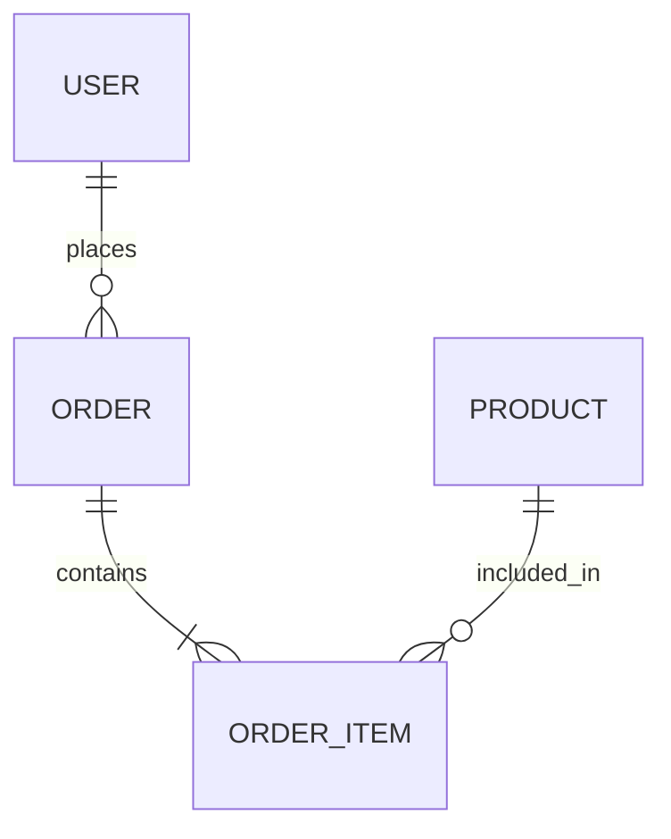

# 🚀 Sprint 01 — Setup (2026/04/27 – 05/02)

## Premise

- One Markdown file is created per sprint. It is the **single source of truth** during the sprint:
  goals, design decisions, tasks and the retrospective.

### What is a `.md` file?

Markdown is the standard text format for sharing documentation in the IT industry.
It can be read anywhere: a text editor, VS Code, a phone, a browser, any OS.

### What is "Docs as Code"?

Traditionally, code lives on GitHub while design documents live in Excel or Word.
Keeping documents in the same plain-text format as the code (and in the same repository)
makes reviews, history and collaboration much easier.

- Reference (Japanese): <https://zenn.dev/dajiaji/articles/24086666031199>

## Project

- Dynamic e-commerce platform with an Instagram-style UI

## 🎯 Goals

1. Learn Markdown and agile workflows
2. Define our agile development rules
3. Set up the development environment
4. Create a mockup
5. Sprint review

## Tasks

### 1. Learn Markdown and agile workflows

- [x] Manage all development documents as `.md` files
- [x] Replace Excel design documents with `.md` files on GitHub
- [x] Mark finished tasks as `[x]` and push

### 2. Define our agile development rules

- [x] Choose the open-source stack

| Technology | Cost | Why we chose it |
| :--- | :--- | :--- |
| **Next.js** | Free (MIT) | The standard React framework. |
| **Tailwind CSS** | Free (MIT) | Utility classes written inline — no separate CSS files. |
| **dbdiagram.io** | Free tier | Database design as text (DBML). The VS Code extension can draw the ER diagram. |
| **Supabase** | Free tier | Authentication, database and storage in one service. Scales to very large datasets. |

> **Note on scalability:** if users can create their own items, records will grow to millions or more.
> Instagram started with a single relational database and soon moved to a distributed one.
> We don't need to solve this now, but **all IDs should be UUIDs from the start**.

### 3. Development environment

- [x] GitHub setup
- [ ] Supabase setup — postponed until we actually need it
- [x] VS Code extensions
  - ESLint: linting
  - Prettier: automatic formatting
  - Tailwind CSS IntelliSense: class name completion
  - vscode-dbml: renders dbdiagram.io diagrams

### 4. Mockup

- [x] Share the initial idea

### 5. Sprint review

- [x] Sunday sprint review (JST 21:00 / FR 12:00, tentative)

## 📅 Plan (week 1)

| Day | Task | Owner | Status |
| --- | --- | --- | --- |
| Mon–Tue | 1 | Both | Done |
| Wed–Fri | 2 | Both | Done |
| Sat | 3, 4 | Both | Done |
| Sun | 5 | Both | Done |

## First ER diagram (draft)

The current schema is in [`docs/database.md`](../database.md).

## Retrospective

### 👍 Good

### 👎 Bad

### ➡️ Next
